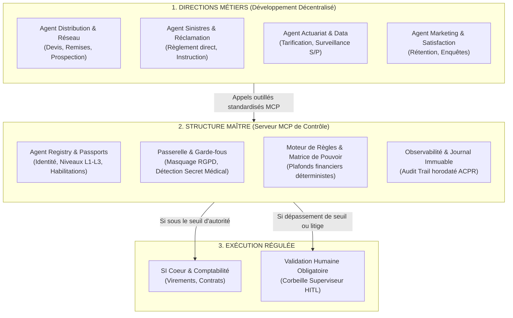

# Gouvernance Agentique d'Entreprise pour l'Assurance 🛡️

[](https://opensource.org/licenses/MIT)
[](https://www.python.org/)
[](https://modelcontextprotocol.io/)
[]()

> **Cadre stratégique, architectural et prototype opérationnel pour gouverner, piloter et contrôler une flotte d'agents IA décentralisés au sein d'une compagnie d'assurance multi-branches.**

---

## 🎯 Vision Exécutive

Dans une compagnie d'assurance (Distribution, Gestion, Sinistres, Réclamations, Actuariat, Marketing), l'avènement de l'IA agentique permet à chaque collaborateur et direction de créer ses propres outils.

Ce projet apporte la solution au dilemme de la Direction Générale : **Permettre la subsidiarité et l'innovation métier décentralisée tout en garantissant une gouvernance absolue, le respect du code des pratiques, la conformité réglementaire (DDA, ACPR, DORA, RGPD) et des plafonds d'autorité financière stricts.**



---

## 📂 Contenu du Répertoire

* **`docs/` & `mkdocs.yml`** : Documentation intégrale en 9 chapitres au format MkDocs (thème Material) détaillant la stratégie, les 6 angles morts, la matrice de délégation, l'architecture et la roadmap.
* **`mcp-server/`** : Prototype opérationnel du Serveur MCP Maître d'Assurance en Python (`mcp 2.3.0`) avec 7 scénarios réels de test.
* **`cockpit/`** : Cockpit visuel interactif HTML/Tailwind pour simuler les interceptions en temps réel et piloter les indicateurs FinOps / conformité.

---

## ⚡ Démarrage Rapide

### 1. Lancer la Démonstration en Direct (Serveur MCP)

```bash
cd mcp-server
python3 -m venv .venv
source .venv/bin/activate
pip install -r requirements.txt

# Lancer la simulation d'un cas sinistre avec interception MCP :
python run_live_demo.py
```

### 2. Exécuter le Banc de Test Automatisé (7 Scénarios)

```bash
python test_client_harness.py
```

**Les 7 contrôles validés :**
1. **Masquage RGPD :** Masquage automatique des IBAN lors de la consultation d'un contrat.
2. **Règlement Direct sous Seuil (450 € < 800 €) :** Virement validé en autonomie L2.
3. **Dépassement de Seuil (1 850 € > 800 €) :** Interception physique et création d'un ticket HITL pour le gestionnaire humain.
4. **Refus de Garantie (Invariant Juridique) :** Interdiction stricte aux agents de refuser une garantie (dossier routé au Juridique).
5. **Secret Médical :** Blocage immédiat de requêtes manipulant des données de santé sans habilitation.
6. **Kill-Switch DORA :** Révocation instantanée d'un agent en anomalie par le RSSI.
7. **Rapport d'Audit ACPR :** Traçabilité immuable avec ID de preuve.

### 3. Consulter la Documentation Complète MkDocs

```bash
pip install mkdocs mkdocs-material
mkdocs serve
# Ouvrir http://127.0.0.1:8000
```

---

## ⚖️ Matrice des Pouvoirs Numériques

| Direction | Opération d'Assurance | Niveau L3 (Autonome) | Niveau L2 (Délégué) | Escalade HITL (L1) |
| :--- | :--- | :--- | :--- | :--- |
| **Gestion des Sinistres** | Indemnisation directe facture réparateur | < 300 € | 300 € à 800 € | > 800 € ou suspicion fraude |
| **Gestion des Sinistres** | Refus formel de garantie | **Interdit** | **Interdit** | **100% Humain obligatoire** |
| **Sinistres Corporels** | Évaluation préjudice & offre indemnité | **Interdit** | **Interdit** | **100% Médecin / Inspecteur** |
| **Distribution / Réseau** | Remise commerciale sur devis annuel | 0% à 3% | 3,1% à 7% | > 7% ou dérogation clauses |
| **Actuariat & Risques** | Modification barème de tarification | **Interdit** | **Interdit** | **Chef Actuaire + DG** |

---

## 📜 Licence & Propriété

Projet développé pour la gouvernance agentique d'entreprise dans le secteur de l'assurance. Sous licence MIT.
