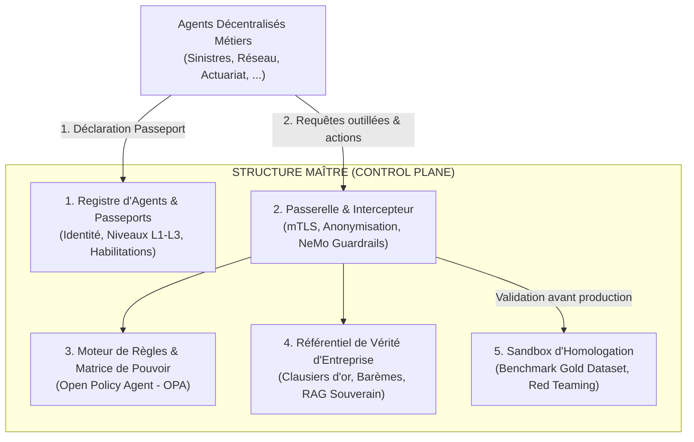

# 3. Architecture du Control Plane

Le **Control Plane** (Structure Maître) constitue la colonne vertébrale régalienne de la plateforme agentique. Il s'articule autour de 5 briques fonctionnelles majeures :

---

## 3.1 Les 5 Briques Fondamentales

### 1. Le Registre des Agents (Agent Registry)
* Tient lieu d'état civil pour tous les agents de l'entreprise.
* Enregistre le **Passeport d'Agent (YAML)**, son propriétaire nominatif, sa direction d'attachement, son niveau d'autonomie (L1, L2 ou L3) et ses quotas de consommation.
* Émet des jetons d'authentification temporaires et révocables (mTLS / JWT cryptographique).

### 2. La Passerelle d'Exécution & Garde-fous (Agent Gateway)
* Point de passage obligatoire pour toute communication entrante ou sortante.
* **Inspection amont (Input Guardrails) :** Analyse les requêtes des utilisateurs pour bloquer les tentatives de prompt injection, le jailbreak et le versement non sollicité de données de santé (Presidio).
* **Inspection aval (Output Guardrails) :** Vérifie que la réponse générée respecte la charte de tonalité de l'entreprise, ne promet pas d'indemnisation non couverte et ne contient pas d'hallucination contractuelle.

### 3. Le Moteur de Règles & Matrice des Pouvoirs (Policy Engine)
* Implémenté en **Policy-as-Code** via Open Policy Agent (OPA).
* Applique de manière déterministe les seuils financiers et juridiques :
    * *Exemple :* Si un agent Sinistres transmet un ordre de paiement > 800 €, le Policy Engine bloque l'appel API vers le progiciel comptable et le transforme automatiquement en ticket d'approbation humaine dans l'outil de gestion.

### 4. Le Référentiel de Vérité d'Entreprise (Enterprise Truth Core)
* Les directions métiers n'ont pas à gérer leurs propres bases documentaires de conditions générales.
* Le Hub central met à disposition un RAG d'entreprise versionné et certifié par la Direction Juridique et l'Actuariat :
    * Conditions Générales et Particulières en vigueur.
    * Barèmes de remboursement et conventions inter-compagnies (IRSA, IRSI, CIDE-COP).
    * Procédures LCB-FT (Lutte contre le blanchiment et le financement du terrorisme).

### 5. La Sandbox d'Homologation & Certification
* Aucun agent ne peut passer en production sans franchir le banc d'essai automatisé du Hub central :
    * **Gold Dataset :** 500 cas réels anonymisés de sinistres ou de souscription testés automatiquement.
    * **Red Teaming Automatisé :** Des agents antagonistes testent la résistance de l'agent métier (tentatives d'extorsion de remises indues, injection de faux documents).
    * **Seuil d'Homologation :** Score de conformité minimale requis (ex: > 98% de conformité aux règles contractuelles).
