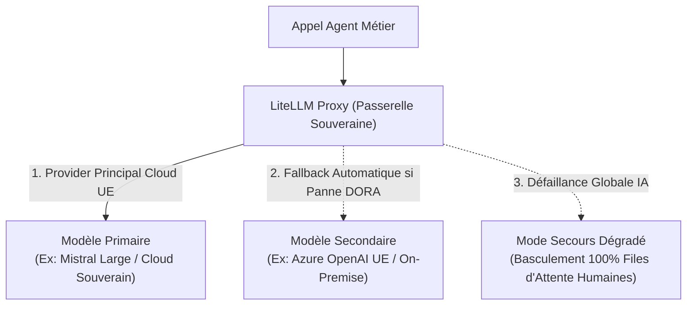

# 6. Stack Technologique & Sécurité

Pour répondre aux exigences de souveraineté européenne (RGPD), de résilience bancaire et assurantielle (**DORA**) et de traçabilité (**ACPR**), la pile technologique recommandée s'appuie sur des briques éprouvées, open-source et auto-hébergeables.

---

## 6.1 Cartographie des Composants Techniques

| Rôle dans la Structure Maître | Solution Recommandée | Justification & Atouts Clés |
| :--- | :--- | :--- |
| **Passerelle LLM & Quotas** | **LiteLLM Proxy** (auto-hébergé) | Routage unifié vers plus de 100 modèles (Mistral, Claude, OpenAI), gestion des budgets par direction, bascule automatique (fallback) DORA. |
| **Garde-fous Entrée/Sortie** | **NeMo Guardrails + Presidio** | Masquage temps réel des données personnelles (PII) et détection des données de santé, contrôle du respect des règles conversationnelles. |
| **Moteur de Règles (Policy-as-Code)** | **Open Policy Agent (OPA)** | Évaluation ultra-rapide des règles métiers et financières (en microsecondes). Découplage complet entre code métier et politique de sécurité. |
| **Registre & Gestion des Passeports** | **FastAPI + PostgreSQL** | API REST interne permettant l'enregistrement des passeports, la gestion du cycle de vie et le Kill-Switch centralisé. |
| **Observabilité & Audit Trail** | **Langfuse** (self-hosted) | Traçabilité immuable de chaque exécution d'agent, des prompts, des réponses, des outils appelés et des coûts par direction. Compatible OpenTelemetry. |
| **Référentiel RAG d'Entreprise** | **Qdrant** ou **pgvector** | Base vectorielle souveraine stockant les clausiers juridiques, conditions générales et barèmes certifiés de la compagnie. |
| **Banc d'Homologation & Tests** | **DeepEval** + **Promptfoo** | Automatisation des tests de régression, d'évaluation de la pertinence contractuelle et de Red Teaming avant déploiement. |

---

## 6.2 Résilience DORA & Haute Disponibilité

Le règlement DORA impose que les processus critiques d'assurance ne dépendent pas d'un point de défaillance unique :

1. **Bascule Automatique :** Si le fournisseur de modèle primaire ne répond plus en moins de 3 secondes ou renvoie une erreur 5xx, la passerelle bascule la requête sur le modèle secondaire de secours.
2. **Circuit Breaker & Kill-Switch :** Tout agent affichant un taux d'erreur supérieur à 5% sur 10 minutes est automatiquement mis en quarantaine. Ses requêtes sont instantanément dérivées vers la boîte de réception des gestionnaires humains.
