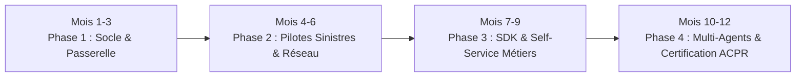

# 7. Feuille de Route & Sprint 0

## 7.1 Calendrier Global de Déploiement (12 Mois)

* **Phase 1 (Mois 1 à 3) : Construction de la Structure Maître (MVP)**
    * Mise en place du registre, de la passerelle LiteLLM et du moteur OPA.
    * Rédaction et validation de la Matrice des Pouvoirs par la Direction Générale et la Conformité.
* **Phase 2 (Mois 4 à 6) : Déploiement de 2 Pilotes Stratégiques**
    * *Pilote 1 (Gestion des Sinistres) :* Agent d'assistance au règlement rapide des bris de glace.
    * *Pilote 2 (Distribution & Réseau) :* Agent d'aide à la consultation des CGV complexes pour les courtiers.
* **Phase 3 (Mois 7 à 9) : Industrialisation & Ouverture aux Métiers**
    * Mise à disposition du SDK interne et des modèles de Passeports.
    * Déploiement du tableau de bord FinOps pour refacturation des tokens aux directions.
* **Phase 4 (Mois 10 à 12) : Écosystème Avancé & Auditabilité Continue**
    * Automatisation des rapports d'audit pour le contrôle périodique et l'ACPR.
    * Premières collaborations inter-agents (ex: Agent Sinistre sollicitant l'Agent Contentieux).

---

## 7.2 Le "Sprint 0" : Vos 30 Premiers Jours

| Semaine | Objectifs Clés | Livrables Concrets |
| :--- | :--- | :--- |
| **Semaine 1** | Gouvernance & Cadrage | - Constitution du Comité de Gouvernance Agentique (DG, DSI, Conformité, Métier). - Validation de la charte de délégation de pouvoir et des seuils financiers. |
| **Semaine 2** | Infrastructure Centrale | - Déploiement de la Passerelle LiteLLM Proxy et du registre PostgreSQL. - Configuration des filtres de sécurité de base (masquage PII / blocage données santé). |
| **Semaine 3** | Câblage du Pilote 1 | - Écriture du passeport `agent-passport.yaml` de l'agent Sinistres. - Validation des tests de dépassement de seuil (> 800 € -> file HITL). |
| **Semaine 4** | Validation & Restitution DG | - Présentation des métriques au Comité de Direction. - Validation du modèle pour extension aux autres directions. |
