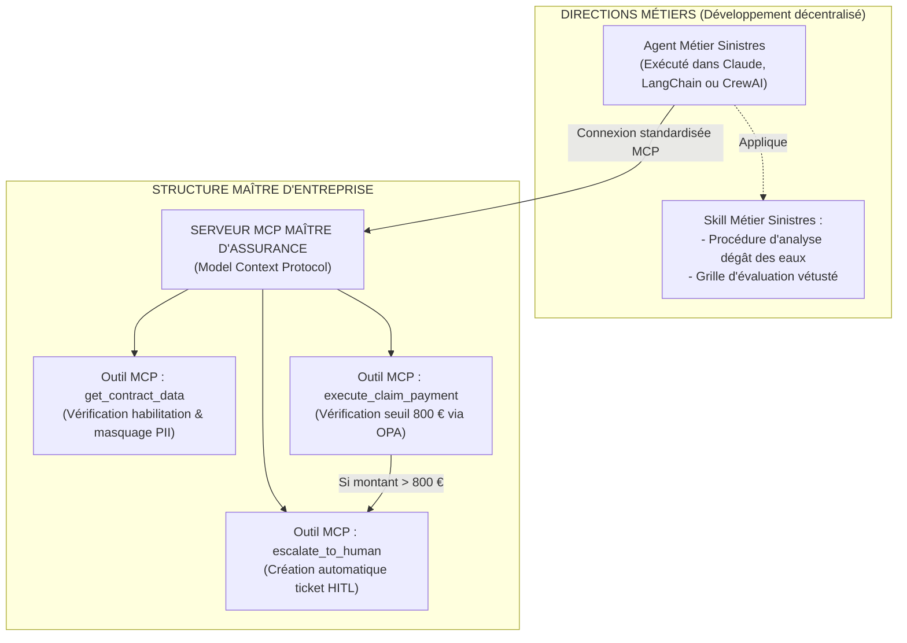

# 8. Guide de Prototypage : Skills vs MCP vs A2A

Pour construire le premier prototype opérationnel de votre structure maître, une question d'architecture logicielle fondamentale se pose : **faut-il modéliser cette gouvernance sous forme de Skills, de serveurs MCP (Model Context Protocol), ou via une orchestration inter-agents A2A (Agent-to-Agent) ?**

---

## 8.1 Analyse Comparative des 3 Approches

| Critère | Approche par "Skills" | Approche par "MCP" (Recommandée) | Approche "A2A" (Agent-to-Agent) |
| :--- | :--- | :--- | :--- |
| **Nature** | Prompts système, instructions procédurales, méta-règles conversationnelles. | Standard de communication client-serveur standardisé pour les outils et les données. | Protocole de dialogue et de négociation direct entre agents autonomes. |
| **Niveau de Contrôle** | **Faible (Soft Control)** : Repose sur la complaisance du LLM (risque d'hallucination ou d'injection). | **Absolu (Hard Control)** : Contrôle d'accès physique, validation déterministe dans le code du serveur. | **Complexe** : Risque de boucle infinie ou de dérive sans socle de contrôle préalable. |
| **Gouvernance des Données** | Difficile à auditer : les données sont injectées dans le prompt. | Parfaite : Le serveur filtre, anonymise et audite chaque appel d'outil avant exécution. | Dépend de la sécurité de chaque sous-agent. |
| **Compatibilité Outils Métiers** | Spécifique à chaque framework ou plateforme. | **Universelle** (Claude, Cursor, LangChain, CrewAI, AutoGen, assistants custom). | Souvent dépendante d'un framework propriétaire. |
| **Rôle Idéal dans l'Entreprise** | **Niveau Spoke (Métier)** : Apprendre à un agent à analyser un dossier d'assurance. | **Niveau Hub (Structure Maître)** : La passerelle de sécurité et de délégation de pouvoir. | **Phase Ultérieure** : Collaboration multi-agents complexe une fois le socle éprouvé. |

---

## 8.2 Le Verdict pour Votre Prototype : Le Tiercé Gagnant

> **Recommandation Formelle : Construisez le coeur de votre prototype sous forme de "Passerelle MCP Maître" (Master MCP Server), complétée par des "Skills" pour les experts métiers.**

### Pourquoi MCP est le choix idéal pour la Structure Maître ?
1. **Agnostique vis-à-vis des choix technologiques des directions :** Une direction peut coder en Python avec LangChain, une autre utiliser Claude Desktop, une troisième utiliser une solution Low-Code. Dès lors qu'elles se connectent au **Master MCP Server** de l'entreprise, elles sont immédiatement gouvernées, sécurisées et auditées sans effort supplémentaire.
2. **Déterminisme et Sécurité d'Assurance :** L'action d'indemniser ou de consulter un dossier n'est pas laissée à l'appréciation d'un prompt ("Skill"), mais exécutée par une fonction informatique contrôlée par le serveur MCP.
3. **Auditabilité Immédiate :** Chaque appel d'outil MCP produit un log structuré horodaté, contenant l'agent demandeur, les paramètres et le résultat.

---

## 8.3 Architecture Concrète du Prototype Recommandé

Pour votre prototype de Sprint 0, mettez en place :

1. **Un Serveur MCP Maître (`insurance-master-mcp-server`) :**
    * Expose 3 outils sécurisés :
        * `get_policy_details(policy_id)` : retourne les garanties en masquant les données personnelles sensibles.
        * `verify_claim_coverage(claim_type, damage_amount)` : interroge le RAG central pour confirmer la garantie.
        * `approve_settlement(claim_id, amount_eur)` : vérifie la règle d'autorité (si montant $\le 800$ €, virement validé ; si montant $> 800$ €, déclenche l'escalade humaine HITL).
2. **Un Skill Métier pour l'Agent Pilote :**
    * Un fichier de consignes métiers expliquant à l'agent de gestion comment accueillir l'assuré, lui demander les justificatifs et appeler les outils du serveur MCP au bon moment.
3. **Réserve pour le A2A :**
    * Laissez le protocole A2A pour la Phase 3. Lancer un prototype en A2A dès le début sans passerelle MCP stable expose votre entreprise à des boucles de communication incontrôlées et à un coût d'ingénierie prématuré.
