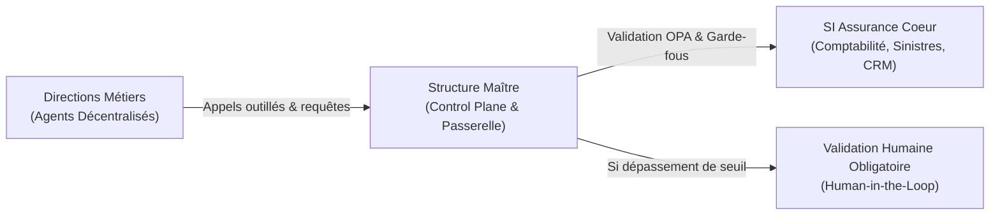

# Gouvernance Agentique d'Entreprise pour l'Assurance

> **Vision Exécutive** : Permettre à chaque direction métier (Distribution, Sinistres, Réseau, Actuariat, Marketing) de créer et d'opérer ses propres agents et outils en toute autonomie, tout en garantissant un contrôle centralisé immuable (conformité ACPR/DDA, conformité RGPD/DORA, plafonds d'engagements financiers et code des pratiques).

---

## Les Trois Principes Directeurs

1. **Subsidiarité Métier :** Le développement des agents est décentralisé. Les experts métiers écrivent leurs cas d'usage, leurs prompts et leurs règles de gestion.
2. **Autorité & Contrôle Centralisés :** Aucun agent ne peut appeler le système d'information de l'entreprise ou interagir avec un client sans être immatriculé et sans transiter par la **Passerelle Maître (Control Plane)**.
3. **Auditabilité & Responsabilité Légale :** Chaque décision prise par un agent est tracée, explicable et bornée par une matrice de délégation de pouvoir numérique formelle.

---

## Organisation de cette Documentation

Cette base de connaissances documente l'intégralité de la stratégie, de l'architecture technique et du plan de déploiement opérationnel :

* **[1. Contexte & Enjeux](01-contexte-et-enjeux.md)** : Analyse de la rupture agentique face à l'organisation traditionnelle d'une compagnie d'assurance.
* **[2. Les 6 Angles Morts](02-angles-morts.md)** : Risques critiques juridiques, réglementaires (ACPR, DORA, Solvabilité II) et dérives de souscription.
* **[3. Architecture du Control Plane](03-architecture-control-plane.md)** : Les 5 briques de la structure maître (Registry, Gateway, Policy Engine, Truth Core, Sandbox).
* **[4. Passeport d'Agent (Spécification)](04-passeport-agent.md)** : Schéma YAML standardisé requis pour l'homologation de chaque agent.
* **[5. Matrice des Pouvoirs & HITL](05-matrice-delegation.md)** : Seuils financiers et déclencheurs d'escalade humaine obligatoire par direction.
* **[6. Stack Technologique & Sécurité](06-stack-technologique.md)** : Choix des technologies souveraines et résilientes (LiteLLM, NeMo, OPA, Presidio, Langfuse).
* **[7. Feuille de Route & Sprint 0](07-feuille-de-route.md)** : Plan de mise en oeuvre sur 12 mois et les 30 premiers jours chrono.
* **[8. Guide de Prototypage : Skills vs MCP vs A2A](08-guide-prototypage.md)** : Analyse comparative et choix architectural recommandé pour le premier prototype.
